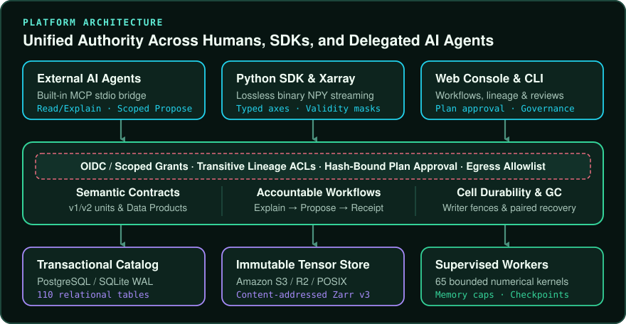

<div align="center">

<picture>
  <source media="(prefers-color-scheme: dark)" srcset="https://raw.githubusercontent.com/tensorus/.github/main/assets/hero-dark.svg">
  <source media="(prefers-color-scheme: light)" srcset="https://raw.githubusercontent.com/tensorus/.github/main/assets/hero-light.svg">
  
</picture>

<br/>

<p>
  <a href="https://tensorus.com"></a>
  <a href="https://tensorus.com/handbook"></a>
  <a href="https://github.com/tensorus/tensorus"></a>
  <a href="mailto:ai@tensorus.com"></a>
</p>

**[Website](https://tensorus.com)** · **[Developer Handbook](https://tensorus.com/handbook)** · **[Python SDK & MCP (`tensorus`)](https://github.com/tensorus/tensorus)** · **[Request Early Access](https://tensorus.com/#connect)**

</div>

---

## Why Tensorus

Modern multimodal AI, robotics, scientific modeling, and quantitative analytics run on **multidimensional numerical arrays**—not flat rows or isolated 1D embedding vectors. Yet teams still stitch together raw `.npy` and `.zarr` buckets, brittle preprocessing scripts, and unconstrained AI agents that can silently corrupt units, masks, or lineage.

Initiated in **December 2024**, **Tensorus** pioneered the **Agentic Tensor Database and Data Lakehouse**—giving developers, scientists, and user-delegated AI agents one verifiable home for multidimensional data:

| Pillar | What Tensorus Delivers |
| :--- | :--- |
| **Native N-Dimensional Storage** | Store, slice, and stream arrays up to 16 dimensions with exact shapes, dtypes, lossless binary `.npy` transfer, and end-to-end **SHA-256** verification. |
| **Physical Units, Coordinates & Masks** | Preserve `Xarray` coordinates, physical units, and explicit boolean **validity masks** so missing or noisy sensor/padding regions never pollute scaling or evaluations. |
| **Safe AI Agent Collaboration (MCP)** | Connect **Claude, Cursor, or custom MCP agents** with scoped, expiring permissions. Agents explore data and **propose** structured plans; execution happens only after **explicit approval**. |
| **Reproducible Releases & MLflow Lineage** | Freeze datasets into immutable **Snapshots** and multi-role **Data Products**, gate new embeddings against golden references, and sync verified lineage directly into **MLflow**. |

---

## Platform Overview

<div align="center">
<picture>
  <source media="(prefers-color-scheme: dark)" srcset="https://raw.githubusercontent.com/tensorus/.github/main/assets/architecture-dark.svg">
  <source media="(prefers-color-scheme: light)" srcset="https://raw.githubusercontent.com/tensorus/.github/main/assets/architecture-light.svg">
  
</picture>
</div>

---

## Unified Python SDK, Xarray, MLflow & MCP Client

Install the official [`tensorus`](https://github.com/tensorus/tensorus) client package (`Python 3.12+`) to connect applications, notebooks, MLflow evaluations, and MCP AI agents to Tensorus:

```bash
pip install "tensorus[mcp,xarray,mlflow]"
```

```python
import numpy as np
from tensorus import Client
from tensorus.models import Operation, PlanDefinition, Step

with Client("https://api.tensorus.com", api_key="tns_...") as client:
    # 1. Create a governed dataset and store an N-dimensional array
    client.create_dataset("ocean_argo", description="Global Argo float temperature grids")
    temperature = np.asarray([[289.15, 290.40], [288.90, 291.05]], dtype="float32")

    v1 = client.put(
        "ocean_argo",
        "sea_surface_temp",
        temperature,
        expected_version=0,
        metadata={"source": "argo-buoy-array", "unit": "K"},
    )

    # 2. Preview (`explain`), propose, and approve an exact plan hash
    definition = PlanDefinition(
        dataset="ocean_argo",
        title="Normalize sea-surface temperature",
        steps=[
            Step(
                id="norm",
                operation=Operation.normalize,
                inputs=[v1["id"]],
                output="sst_norm",
            )
        ],
    )
    preflight = client.explain(definition)
    plan = client.propose(definition)
    client.approve(plan["id"], plan["plan_hash"])
    finished = client.wait(plan["id"], timeout=60)
```

---

<div align="center">

**Built for multimodal AI, scientific computing, and agentic data engineering teams.**  
[tensorus.com](https://tensorus.com) · [tensorus.com/handbook](https://tensorus.com/handbook) · `ai@tensorus.com`

</div>
