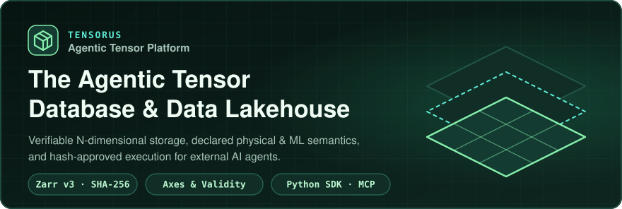

<div align="center">

<picture>
  <source media="(prefers-color-scheme: dark)" srcset="https://raw.githubusercontent.com/tensorus/.github/main/assets/hero-dark.svg">
  <source media="(prefers-color-scheme: light)" srcset="https://raw.githubusercontent.com/tensorus/.github/main/assets/hero-light.svg">
  
</picture>

<br/>

**[Website](https://tensorus.com)** · **[Python SDK (`tensorus`)](https://pypi.org/project/tensorus/)** · **[Model Context Protocol (MCP)](https://github.com/tensorus/mcp)** · **[Samples & Workflows](https://github.com/tensorus/samples)** · **[Datasets](https://github.com/tensorus/datasets)** · **[Contact](mailto:ai@tensorus.com)**

</div>

---

## Why Tensorus

Modern scientific computing, physical simulation, multimodal AI, and quantitative engineering run on **multidimensional numerical arrays**—not flat rows or isolated 1D embedding vectors. Yet teams still stitch together ad-hoc object buckets, unvalidated `.npy`/`.zarr` files, brittle scripts, and unconstrained AI agents that can silently corrupt units, masks, or provenance.

**Tensorus** is an **Agentic Tensor Database and Data Lakehouse** purpose-built so developers, scientists, and user-delegated AI agents operate on one verifiable numerical foundation:

| Pillar | What Tensorus Guarantees |
| :--- | :--- |
| **Verifiable Numerical Identity** | Every tensor version is stored in immutable, content-addressed **Zarr v3** chunks with canonical little-endian **SHA-256** digests, lossless binary **NPY** streaming, optimistic head concurrency (`expected_version`), and idempotent retries. |
| **Declared Physical & ML Semantics** | First-class dimensional axes, physical units, coordinate systems (`v1`/`v2`), explicit boolean validity/missingness masks, and immutable dataset/release contracts prevent silent unit or axis mismatches before execution. |
| **Safe Delegated Agent Execution** | External AI agents (**Claude, Cursor, custom MCP hosts, and scoped SDK clients**) inspect schemas, run nondurable preflight (`explain`), and propose typed multi-step plans (`propose`). Execution requires **hash-bound human or trusted-application approval (`plan_hash`)**, runs on lease-fenced workers across **65 bounded numerical kernels**, and emits auditable cryptographic receipts. |
| **Enterprise Governance & Cloud Durability** | Workspace isolation, OIDC/PKCE identity & multi-workspace organizations, **transitive lineage Dataset ACLs** (`restricted_acl_v1`), outbound egress allowlists, two-phase physical garbage collection, paired catalog/object recovery with incarnation writer fences, and regional cell authority. |

---

## Unified Platform Architecture

<div align="center">
<picture>
  <source media="(prefers-color-scheme: dark)" srcset="https://raw.githubusercontent.com/tensorus/.github/main/assets/architecture-dark.svg">
  <source media="(prefers-color-scheme: light)" srcset="https://raw.githubusercontent.com/tensorus/.github/main/assets/architecture-light.svg">
  
</picture>
</div>

---

## Developer Experience in 30 Seconds

Connect from Python, **Xarray**, or any **Model Context Protocol (MCP)** agent host—store exact numerical arrays, run preflight verification, and execute approved plans with end-to-end lineage:

```python
import numpy as np
from tensorus import Client

with Client("https://api.tensorus.com", api_key="tsr_...") as client:
    # 1. Create a governed dataset and store a canonical N-dimensional array
    client.create_dataset("ocean_argo", description="Global Argo float temperature grids")
    temperature = np.asarray([[289.15, 290.40], [288.90, 291.05]], dtype="float32")

    v1 = client.put(
        "ocean_argo",
        "sea_surface_temp",
        temperature,
        expected_version=0,
        metadata={"source": "argo- buoy-array", "unit": "K"},
    )

    # 2. Propose a bounded numerical workflow (agents can propose; humans/apps approve exact plan_hash)
    plan = client.propose_plan(
        dataset="ocean_argo",
        title="Normalize sea surface temperature",
        steps=[{"id": "norm", "operation": "normalize", "inputs": [v1["id"]], "output": "sst_norm"}],
    )
    client.approve_plan(plan["id"], plan["plan_hash"])
```

---

## Ecosystem & Public Repositories

| Repository | Role | Status |
| :--- | :--- | :--- |
| **[`tensorus/tensorus`](https://github.com/tensorus/tensorus)** | Official **Python SDK**, CLI client, Xarray integration, and open developer interfaces (`pip install tensorus`) | Official SDK Hub |
| **[`tensorus/mcp`](https://github.com/tensorus/mcp)** | **Model Context Protocol (MCP)** integration for safe, read-by-default external AI agent workflows | Public · MIT |
| **[`tensorus/samples`](https://github.com/tensorus/samples)** | End-to-end scientific, ML feature-engineering, and agentic tensor workflow blueprints | Public · MIT |
| **[`tensorus/datasets`](https://github.com/tensorus/datasets)** | Curated multidimensional tensor datasets for benchmarking, simulation, and onboarding | Public · MIT |
| **[`tensorus/models`](https://github.com/tensorus/models)** | Reference tensor models and domain-specific numerical pipelines | Public · MIT |

---

<div align="center">

**Built for global scientific, ML, and agentic data engineering teams.**  
[tensorus.com](https://tensorus.com) · `ai@tensorus.com`

</div>
